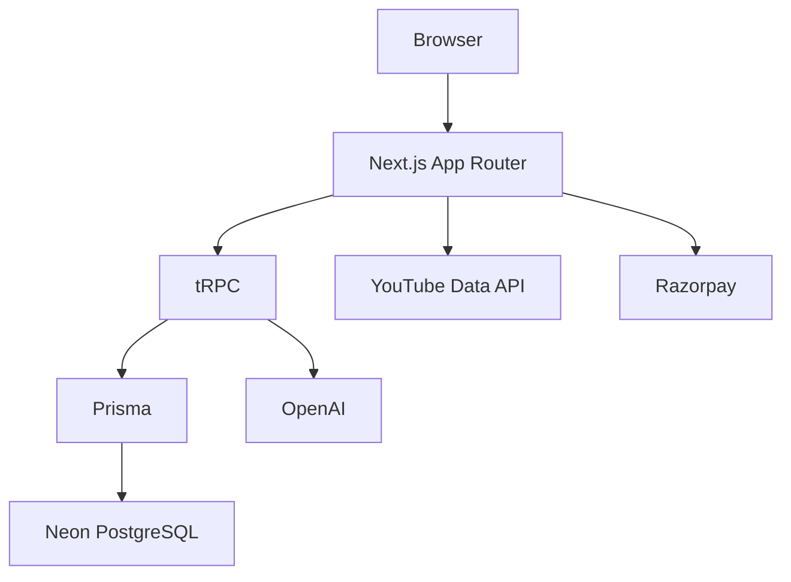

<div align="center">

# Saviours AI

**An ICSE Class 10 board-preparation workspace**

[Live Platform](https://saviours.pro)


</div>

---

## What it is

Saviours AI gives ICSE Class 10 students a structured place to plan study time, learn chapter-by-chapter, practise exam-style questions, and track preparation. The product has a Free plan and one paid plan: **Pro, ₹99 one-time**.

Sidekick Ebooks are a Pro-only, in-platform reading library. Students can read them in the React PDF viewer; download controls are intentionally not provided.

## Current product status

Feature visibility is controlled in `src/lib/featureFlags.ts`. The lists below describe the current student-facing product, not every route that exists in the codebase.

### Active features

| Feature | Who can use it | What it does |
|---|---|---|
| Dashboard | Free and Pro | Shows a student’s preparation overview, plan status, Monthly Mission progress, and available tools. |
| Smart Planner | Free and Pro | Creates a chapter-aware daily study plan from subjects, difficulty, and available time. Plans can be completed, edited, cleared, and viewed as a timeline. |
| Monthly Mission | Free and Pro | An 11-month ICSE preparation roadmap with weekly tasks and add-ons. Completion is saved locally in the browser. |
| Study Flow | Free and Pro | A chapter journey with Watch, Revise, and Practice steps. Watch uses YouTube search, revision presents concepts, and practice checks answers. |
| Video Lectures | Free and Pro | Subject lecture library with one-shots, marathons, competency-question videos, and an all-subject marathon playlist. |
| Pre-Board 60 | Free and Pro | A 60-day pre-board programme: the initial study phase is free; Pro unlocks practice and mock-paper phases. |
| Subjects | Free and Pro | Browse ICSE subjects and their chapter structure. |
| Profile and Activity | Free and Pro | Manage profile details and review study activity. |
| Guess Papers | Pro | Subject-wise, PYQ-informed guess-paper preparation with a professional dashboard experience. |
| Competency Practice | Pro | Timed, PYQ-based question practice with accuracy, timing, chapter-level analysis, and improvement insights. |
| Customise Test | Pro | Builds tailored MCQ tests from selected subjects, chapters, difficulty, and question counts. |
| Flip the Question | Pro | A reverse-engineering coding challenge where students reconstruct a question and receive AI evaluation. |
| Focus Mode | Pro | Pomodoro, deep-focus, and light-focus sessions with logging and recent-session history. |
| ChronoScroll | Pro | Interactive History and Civics timeline and quick-recall learning cards. |
| Numerical Mastery | Pro | Physics numerical practice organised by chapter and topic, with formulas, worked examples, PYQs, and mastery tracking. |
| Sidekick Ebooks | Pro | Ten ICSE subject e-books read inside the platform with the React PDF viewer. |

### Hidden or coming-soon features

| Feature | Status | Intended functionality |
|---|---|---|
| AI Doubt Solver | Hidden | ICSE-focused AI chat with image/PDF support, step-by-step explanations, and recommended learning resources. |
| Live Webinar | Hidden | A session-details and booking page for free live classes. |
| Half Yearly Simulator | Hidden | Guided half-syllabus preparation with lesson videos, reading, competency testing, and chapter progress. |
| Date Battle Arena | Hidden | A timed history-date learning game with streaks and score progression. |
| Exam Strategy Builder | Hidden | Builds an exam strategy from a student’s strengths, weaknesses, goals, and schedule. |
| Last Night Before | Hidden | A last-minute revision sprint with numericals, formulas, definitions, and randomised revision sets. |
| Smart Notes and Flashcards | Hidden | AI-assisted note refinement, revision sheets, and flashcard generation. |
| Tracker | Hidden | A board-preparation tracker viewer. |
| Scholarship test | Hidden and disabled | The scholarship flow is not shown to students and cannot discount Pro checkout. |

## Plans and access

| Plan | Price | Includes |
|---|---:|---|
| Free | ₹0 | Dashboard, Smart Planner, Monthly Mission, Study Flow, Video Lectures, the first Pre-Board 60 phase, subjects, profile, and activity. |
| Pro | **₹99 one-time** | Everything in Free plus Sidekick Ebooks, Guess Papers, Competency Practice, Customise Test, Flip the Question, Focus Mode, ChronoScroll, Numerical Mastery, and the paid Pre-Board 60 phases. |

- There is no Ultimate or Bundle plan.
- Pro is a one-time Razorpay purchase; it is not a subscription.
- Sidekick Ebooks are available to Pro students in the in-platform reader only; no download option is offered.
- Scholarship discounts are disabled: Pro checkout is always ₹99.

## Technology



- Next.js 16 and React 19
- TypeScript
- Prisma and Neon PostgreSQL
- tRPC and React Query
- JWT authentication with credential and Google OAuth flows
- Razorpay for the one-time Pro purchase
- OpenAI and YouTube APIs for enabled learning tools

## Colour system

The current interface is a restrained dark dashboard. **Electric cyan is the only primary accent.**

| Role | Token | Value | Usage |
|---|---|---:|---|
| Base background | `--bg-base` | `#0D0D1A` | App canvas and page background |
| Surface | `--bg-surface` | `#13131F` | Cards, sidebars, and modals |
| Elevated surface | `--bg-elevated` | `#1A1A2E` | Raised controls, menus, and selected areas |
| Borders | `--bg-border` | `#252538` | Card and input boundaries |
| Primary text | `--text-primary` | `#F5F0E8` | Headings and high-emphasis content |
| Secondary text | `--text-secondary` | `#B0AABA` | Supporting copy |
| Muted text | `--text-muted` | `#6B6B80` | Labels and inactive metadata |
| Primary accent | `--accent-gold`* | `#00D4FF` | Cyan CTAs, active navigation, focus states, and progress |
| Accent hover | `--accent-gold-dim`* | `#00A3CC` | Cyan hover and pressed states |
| Accent glow | `--accent-gold-glow`* | `rgba(0, 212, 255, 0.15)` | Subtle cyan fills and emphasis |
| Success | `--status-green` | `#3ECF8E` | Completed and positive states |
| Error | `--status-red` | `#F87171` | Errors and destructive states |
| Informational | `--status-blue` | `#60A5FA` | Informational indicators |
| Caution | `--status-orange` | `#FB923C` | Warnings only, never a primary brand accent |

\*These legacy variable names are retained for compatibility with existing components; their rendered values are cyan. Buttons and active UI use restrained cyan borders and translucent fills rather than bright multi-colour gradients.

## Project structure

```text
src/
  app/            routes, dashboard pages, API routes
  components/     dashboard chrome, onboarding, shared UI, payments
  data/           question banks, video data, study-flow content
  hooks/          responsive and application hooks
  lib/            authentication, access control, feature flags, utilities
  server/         tRPC context and routers
prisma/
  schema.prisma   database schema
```

## Configuration

The main student-facing feature switchboard is `src/lib/featureFlags.ts`. Set a flag to `true` to expose a feature only after it is production-ready.

```env
DATABASE_URL=
JWT_SECRET=
NEXT_PUBLIC_BASE_URL=
GOOGLE_CLIENT_ID=
GOOGLE_CLIENT_SECRET=
OPENAI_API_KEY=
YOUTUBE_API_KEY=
NEXT_PUBLIC_RAZORPAY_KEY_ID=
RAZORPAY_KEY_SECRET=
RAZORPAY_WEBHOOK_SECRET=
```

## Commands

```bash
npm run dev      # Start the local development server
npm run build    # Generate Prisma client and create a production build
npx tsc --noEmit # Type-check the application
```
